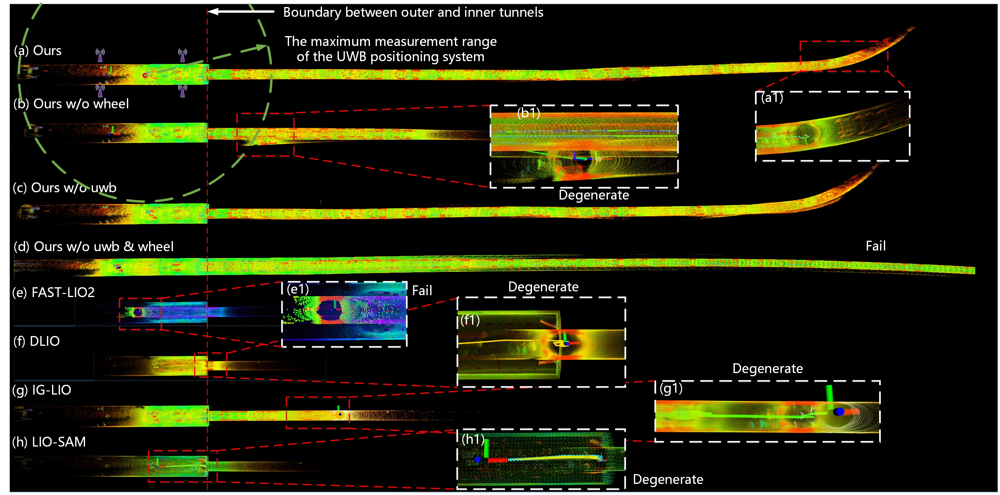
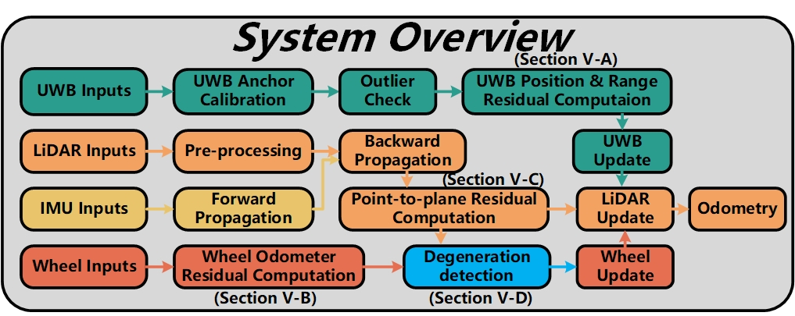

<div align="center">

# CM-LIUW-Odometry

### Robust and High-Precision LiDAR-Inertial-UWB-Wheel Odometry for Extreme Degradation Coal Mine Tunnels

**IEEE/RSJ International Conference on Intelligent Robots and Systems (IROS 2025)**

[Kun Hu](https://github.com/KJ-Falloutlast)<sup>1</sup> ·
[Menggang Li](https://orcid.org/0000-0002-2395-9543)<sup>1,†</sup> ·
[Zhiwen Jin](https://orcid.org/0009-0008-6412-4711)<sup>1</sup> ·
[Chaoquan Tang](https://orcid.org/0000-0003-1641-9845)<sup>1</sup> ·
[Eryi Hu](https://orcid.org/0000-0002-3932-4542)<sup>2</sup> ·
[Gongbo Zhou](https://orcid.org/0000-0002-8672-2535)<sup>1</sup>

<sup>1</sup> China University of Mining and Technology, Xuzhou, China<br>
<sup>2</sup> Information Institute, Ministry of Emergency Management, China<br>
<sup>†</sup> Corresponding author

[](https://kj-falloutlast.github.io/CM-LIUW-Odometry/)
[](https://doi.org/10.1109/IROS60139.2025.11245914)
[](https://arxiv.org/abs/2511.01379)
[](https://pan.baidu.com/s/1F0kvzPzChDI4oLQsRmwrgg?pwd=idnx)

[](https://releases.ubuntu.com/20.04/)
[](https://wiki.ros.org/noetic)
[](LICENSE)
[](https://github.com/KJ-Falloutlast/CM-LIUW-Odometry/stargazers)

**[Project Page](https://kj-falloutlast.github.io/CM-LIUW-Odometry/)** ·
**[Paper](https://doi.org/10.1109/IROS60139.2025.11245914)** ·
**[arXiv](https://arxiv.org/abs/2511.01379)** ·
**[Video](https://www.bilibili.com/video/BV1ThVZ6LESW/)** ·
**[Dataset](#dataset)** ·
**[Citation](#citation)**

</div>

<p align="center">
  <a href="https://www.bilibili.com/video/BV1ThVZ6LESW/">
    
  </a>
  <br>
  <em>CM-LIUW-Odometry remains stable after leaving UWB coverage, while LiDAR-only and ablated variants drift or degenerate. Click to watch the IROS 2025 demonstration.</em>
</p>

## At a glance

CM-LIUW-Odometry is a tightly coupled **LiDAR–IMU–UWB–wheel** odometry system for long, repetitive, GPS-denied coal mine tunnels. It combines global UWB constraints, wheel odometry with nonholonomic and lever-arm compensation, and covariance-based degradation detection inside one Iterated Error-State Kalman Filter (IESKF). The estimator switches between **LIU**, **LIO**, and **LIW** modes according to UWB availability and environmental degeneracy.

| Global reference | Beyond UWB range | Degeneracy awareness | Estimator |
|:---:|:---:|:---:|:---:|
| UWB position + range | Wheel odometry + NHC | Covariance PCA/SVD | Tightly coupled IESKF |

## News

- **2026-08-23** — Source code, reproducible installation guide, project page, and the underground ROS bag released.
- **2025-11-04** — Updated manuscript released on [arXiv](https://arxiv.org/abs/2511.01379).
- **2025-06-16** — CM-LIUW-Odometry accepted to **IROS 2025**. 🎉

## Method

<p align="center">
  
  <br>
  <em>System overview. UWB, LiDAR, IMU, and wheel constraints are updated in a unified IESKF.</em>
</p>

The system contributes three components for extreme-degradation tunnels:

1. **Global-coordinate alignment.** UWB position and range residuals constrain LiDAR–inertial odometry inside the UWB coverage region.
2. **Robust estimation beyond UWB.** Tightly coupled wheel odometry, nonholonomic constraints, and lever-arm compensation suppress drift after UWB measurements disappear.
3. **Adaptive motion modes.** Covariance decomposition detects the direction and severity of degeneration and activates the appropriate LIU/LIO/LIW fusion mode.

## Installation

### 1. Tested environment

The default, core estimator has been tested with the following software stack:

- Ubuntu 20.04 LTS, ROS Noetic, GCC 9.4
- CMake ≥ 3.10 and C++14
- Eigen 3, PCL 1.8+, OpenCV 4, Ceres Solver, GeographicLib, Boost
- `catkin_tools`
- Livox ROS Driver v2.6.x for Livox `CustomMsg` support

> [!NOTE]
> The optional PALoc pose-graph node is disabled by default. It additionally requires **GTSAM** and the **Open3D C++ SDK**; neither is required for the core `cm_liuw_slam` estimator.

### 2. Install ROS and system dependencies

Install [ROS Noetic](https://wiki.ros.org/noetic/Installation/Ubuntu), then run:

```bash
sudo apt update
sudo apt install -y \
  build-essential cmake git python3-catkin-tools python3-dev \
  libboost-all-dev libceres-dev libeigen3-dev libgeographic-dev \
  libgflags-dev libgoogle-glog-dev libopencv-dev libpcl-dev \
  ros-noetic-eigen-conversions ros-noetic-pcl-ros \
  ros-noetic-tf-conversions
```

### 3. Clone and build

This repository is a ready-to-build Catkin workspace. Clone it with its Livox driver submodule:

```bash
git clone --recursive https://github.com/KJ-Falloutlast/CM-LIUW-Odometry.git
cd CM-LIUW-Odometry

source /opt/ros/noetic/setup.bash
rosdep install --from-paths src --ignore-src -r -y

catkin config \
  --extend /opt/ros/noetic \
  --cmake-args -DCMAKE_BUILD_TYPE=Release -DBUILD_PGO=OFF
catkin build common_msgs livox_ros_driver cm_liuw_odometry

source devel/setup.bash
```

If the repository was cloned without `--recursive`, initialize the dependency with:

```bash
git submodule update --init --recursive
```

### 4. Configure your sensors

Copy the closest file under [`src/cm_liuw_odometry/config`](src/cm_liuw_odometry/config) and update the topics, noise values, timestamps, and calibrated extrinsics before running. The four required input contracts are:

| Modality | ROS message | Configuration key |
|---|---|---|
| LiDAR | `sensor_msgs/PointCloud2` or `livox_ros_driver/CustomMsg` | `common/lid_topic` |
| IMU | `sensor_msgs/Imu` | `common/imu_topic` |
| Wheel odometry | `nav_msgs/Odometry` | `common/wheel_topic` |
| UWB | `common_msgs/UWB_FullNeighborDatabase` | `common/uwb_topic` |

Set `common/use_wheel` and `common/use_uwb` to enable the corresponding fusion updates. **Do not reuse the provided extrinsics or anchor coordinates unless they match your own calibrated rig.**

### 5. Run

For a Livox Avia LiDAR–IMU setup:

```bash
source /opt/ros/noetic/setup.bash
source devel/setup.bash
roslaunch cm_liuw_odometry mapping_avia.launch
```

Play your sensor bag in another terminal:

```bash
source devel/setup.bash
rosbag play /absolute/path/to/your_sequence.bag
```

Primary outputs include:

| Topic | Type | Description |
|---|---|---|
| `/Odometry_ori` | `nav_msgs/Odometry` | Fused odometry |
| `/path_ori` | `nav_msgs/Path` | Estimated trajectory |
| `/cloud_registered_ori` | `sensor_msgs/PointCloud2` | Registered point cloud in the world frame |
| `/cloud_registered_body_ori` | `sensor_msgs/PointCloud2` | Registered point cloud in the body frame |
| `/Laser_map_ori` | `sensor_msgs/PointCloud2` | Incremental map |

### Optional PALoc/PGO build

After installing compatible GTSAM and Open3D C++ development packages, rebuild with:

```bash
catkin config --cmake-args -DCMAKE_BUILD_TYPE=Release -DBUILD_PGO=ON
catkin build cm_liuw_odometry
```

## Dataset

> **Release status: public ROS bag available.** [Download from Baidu Netdisk](https://pan.baidu.com/s/1F0kvzPzChDI4oLQsRmwrgg?pwd=idnx) with extraction code **`idnx`**.

The dataset used for the IROS 2025 real-world experiment was collected with the **CUMT 5** mobile robot in an extreme-degradation underground coal mine tunnel.

| Sequence | Environment | Sensor suite | Ground truth | Status |
|---|---|---|---|---|
| `CM-LIUW-CoalMine` | Long, repetitive, feature-poor coal mine tunnel | Robosense 32 LiDAR, Xsens-G710 IMU, p440 UWB, wheel odometry | 15 total-station reference points | **[Download](https://pan.baidu.com/s/1F0kvzPzChDI4oLQsRmwrgg?pwd=idnx)** |

Current public file:

- `cm-liuw-odometry-underground-dataset-2025-01-13-16-10-36-zhefan-continuous-go.bag`
- Baidu Netdisk extraction code: `idnx`

After downloading, inspect and play the bag with:

```bash
rosbag info cm-liuw-odometry-underground-dataset-2025-01-13-16-10-36-zhefan-continuous-go.bag
rosbag play cm-liuw-odometry-underground-dataset-2025-01-13-16-10-36-zhefan-continuous-go.bag
```

Calibration files, the topic manifest, total-station evaluation files, checksums, mirrors, and a standalone dataset license are not yet included in this repository. They will be linked here and on the [project page](https://kj-falloutlast.github.io/CM-LIUW-Odometry/#dataset) as they become available. Until the dataset license is published, please contact the authors before redistributing the bag.

## Repository layout

```text
CM-LIUW-Odometry/
├── src/
│   ├── cm_liuw_odometry/   # estimator, configs, launch files, RViz
│   ├── common_msgs/        # UWB/navigation message definitions
│   └── livox_ros_driver/   # pinned Git submodule
├── doc/                    # paper figures used by the README
├── docs/                   # GitHub Pages project website
├── CITATION.cff
└── LICENSE
```

## Citation

If this work helps your research, please cite the IROS paper and consider giving the repository a star.

```bibtex
@inproceedings{hu2025cmliuw,
  author    = {Kun Hu and Menggang Li and Zhiwen Jin and Chaoquan Tang and Eryi Hu and Gongbo Zhou},
  title     = {{CM-LIUW-Odometry}: Robust and High-Precision {LiDAR}-Inertial-{UWB}-Wheel Odometry for Extreme Degradation Coal Mine Tunnels},
  booktitle = {2025 IEEE/RSJ International Conference on Intelligent Robots and Systems (IROS)},
  year      = {2025},
  pages     = {7139--7146},
  doi       = {10.1109/IROS60139.2025.11245914}
}
```

## Acknowledgments

This project builds upon ideas and open-source components from [FAST-LIO2](https://github.com/hku-mars/FAST_LIO), [UWB Localization](https://github.com/lijx10/uwb-localization), [slam_in_autonomous_driving](https://github.com/gaoxiang12/slam_in_autonomous_driving), [PALoc](https://github.com/JokerJohn/PALoc), and [FAST-LIO-Multi-Sensor-Fusion](https://github.com/zhh2005757/FAST-LIO-Multi-Sensor-Fusion). We thank their authors for their contributions to the robotics community.

## License and support

The source code is released under the [GNU General Public License v2.0](LICENSE), consistent with the FAST-LIO2 codebase on which part of this system builds. Existing third-party copyright and license notices remain applicable. Dataset terms will be published with the dataset archive.

For reproducibility questions, please [open an issue](https://github.com/KJ-Falloutlast/CM-LIUW-Odometry/issues) and include your Ubuntu/ROS version, sensor model, launch file, configuration diff, and the first relevant error message.

<div align="center">

Made for robust autonomy where GPS and geometry both disappear.

</div>
